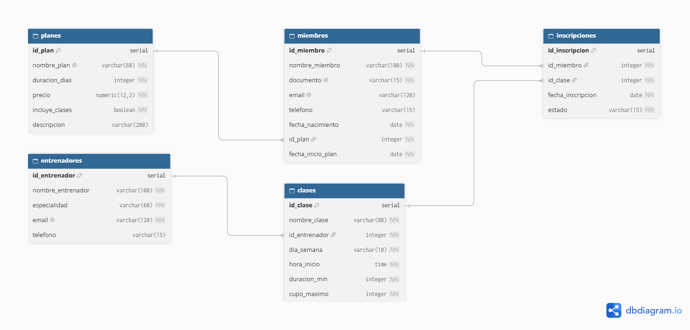

# Iron Paradise Gym

Sistema web administrativo para la gestión de un gimnasio, hecho con Flask y PostgreSQL.

**Curso:** Programación Web · Proyecto final

## Integrantes

- Jose Daniel Cerquera Ramírez
- John Sebastián Meza Saldaña

## Descripción del tema

Iron Paradise Gym es una aplicación para que el personal administrativo de un gimnasio gestione sus datos desde el navegador. Permite administrar:

- **Planes** de membresía (nombre, duración, precio y si incluyen clases grupales).
- **Miembros** afiliados y el plan que tienen contratado.
- **Entrenadores** que dictan las clases.
- **Clases** grupales con día, hora y cupo.
- **Inscripciones** de los miembros a las clases.

La aplicación valida los datos en el servidor y aplica reglas de negocio, por ejemplo: solo se inscriben a clases los miembros cuyo plan las incluye, no se supera el cupo de una clase y un miembro no puede inscribirse dos veces en la misma. El diseño completo de la base de datos está en [`docs/diccionario_de_datos.md`](docs/diccionario_de_datos.md).

**Tecnologías:** Python, Flask, PostgreSQL (psycopg2), Bootstrap 5, pytest.

## Modelo entidad-relación (MER)



Resumen de las relaciones:

| Relación | Cardinalidad |
|---|---|
| planes – miembros | 1:N |
| entrenadores – clases | 1:N |
| miembros – clases | N:M (resuelta con `inscripciones`) |

## Instalación

### Requisitos

- Python 3.10 o superior
- PostgreSQL
- Git

### Pasos

1. **Clonar el repositorio**

   ```bash
   git clone https://github.com/SebDev777/ProyectoFinal-ProgramacionWeb proyecto
   cd proyecto
   ```

2. **Crear, activar el entorno virtual e instalar dependencias**

  ```bash
  bash setup.sh
  ```

  En caso de que no se abra el entorno virtual:
  source .venv/Scripts/activate

3. **Crear la base de datos** `gimnasio_db` en PostgreSQL y cargar el script de tablas:

   ```bash
   createdb gimnasio_db
   psql -d gimnasio_db -f gimnasio_db_script.sql
   ```

5. **Configurar las variables de entorno.** Copia el archivo de ejemplo y completa tus datos:

   ```bash
   cp .env.example .env      # Windows: copy .env.example .env
   ```

   Edita `.env` con los datos de tu PostgreSQL (servidor, puerto, nombre de la base, usuario y contraseña).

> El archivo `.env` contiene credenciales y no se sube al repositorio.

## Ejecución

Con el entorno virtual activo y PostgreSQL encendido:

```bash
py app.py
```

Abre en el navegador: <http://127.0.0.1:5000>

Si PostgreSQL está apagado o el `.env` es incorrecto, la aplicación muestra una página de error de conexión.

## Pruebas

Las pruebas de punta a punta del CRUD están en la carpeta `tests/` y se ejecutan contra la base de datos real. Cada prueba crea sus propios registros (prefijo `ZZ_TEST_`) y los elimina al terminar.

```bash
py -m pytest -v
```

El plan de pruebas con sus casos y evidencias está en [`docs/plan_de_pruebas.md`](docs/plan_de_pruebas.md).

## Capturas de la aplicación

| Inicio | Listado de planes |
|---|---|
|  |  |

| Formulario de plan | Confirmación al eliminar |
|---|---|
|  |  |

## Estructura del proyecto

```
├── app.py                  # Aplicación Flask
├── config.py               # Configuración (lee el .env)
├── db.py                   # Conexión y consultas a PostgreSQL
├── validators.py           # Validación de formularios
├── routes/                 # Rutas (un archivo por módulo)
├── templates/              # Plantillas HTML (Jinja)
├── static/                 # CSS e imágenes
├── tests/                  # Pruebas con pytest
├── docs/                   # Documentación, MER, capturas y plan de pruebas
├── requirements.txt
├── requirements-dev.txt
└── .env.example
```

## Documentación

- [Diccionario de datos y normalización](docs/diccionario_de_datos.md)
- [Plan de pruebas](docs/plan_de_pruebas.md)
